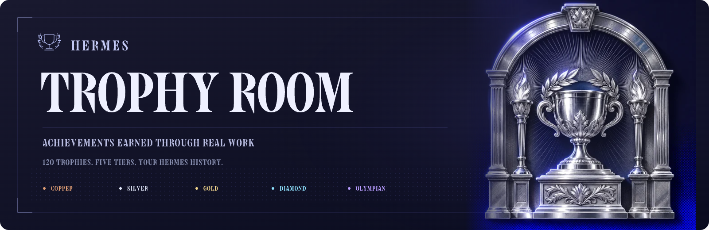
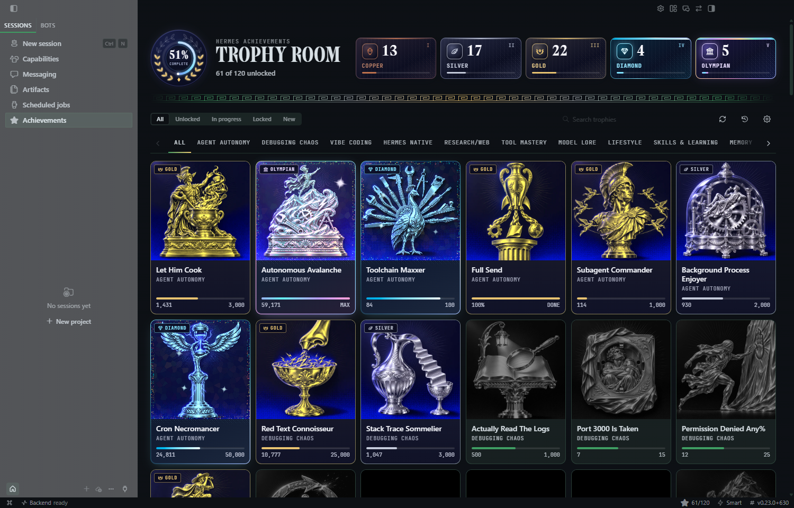
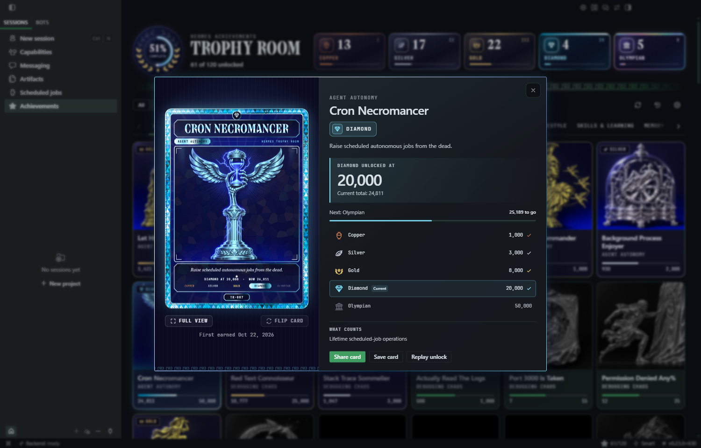
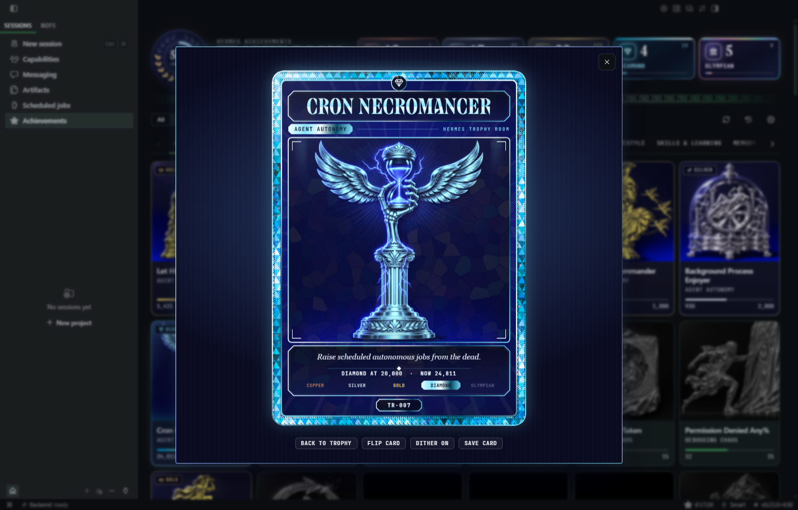
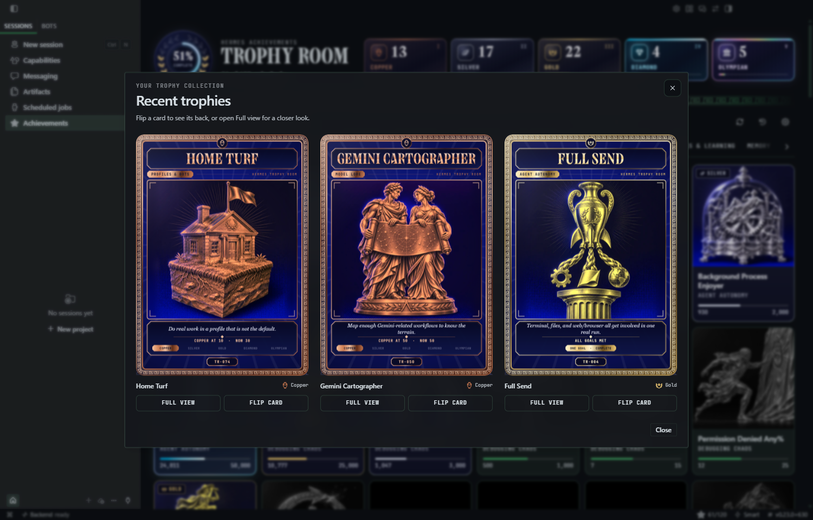
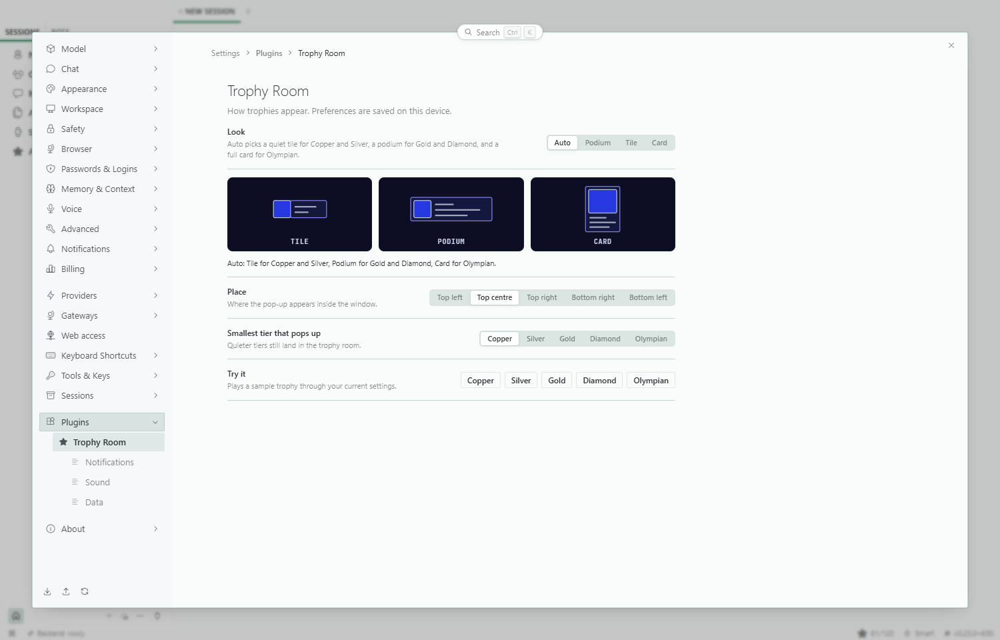
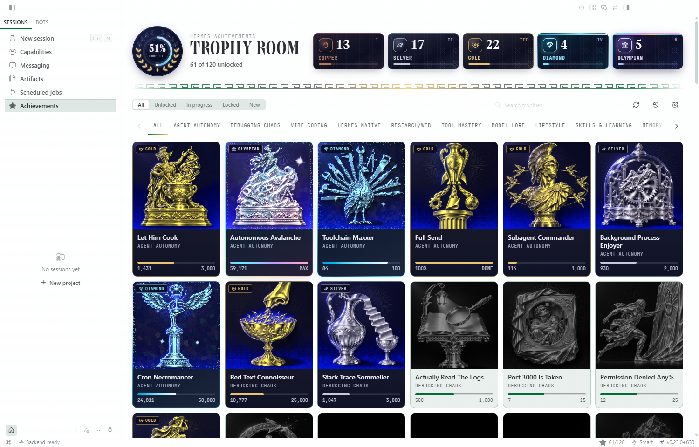
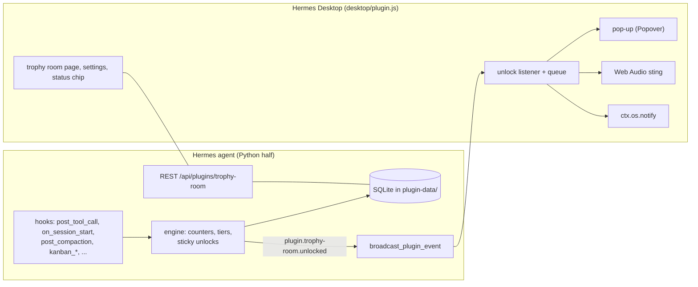

<p align="center">
  
</p>

**Achievements for Hermes Desktop.** Turn real work with tools, skills, profiles, scheduled jobs, plugins, and more into a collection worth keeping.

Trophy Room includes **120 illustrated trophies across 18 categories**, collectible cards, animated unlock notifications, and optional sound. Progress comes from Hermes activity, not from asking a model to award points.



Screenshots show the actual plugin in Hermes Desktop with demonstration progress.

## What you get

- **A collection with progression.** Copper, Silver, Gold, Diamond, and Olympian ranks, plus goal-based trophies with their own requirements. Eighteen trophies stay secret until you discover them.
- **A pop-up with presence.** Three looks: Podium (drops from the title bar), Tile (a picture that unfolds into a strip) and Card (the big moment). With the default `auto` look, small tiers get a Tile, Gold and Diamond a Podium, and Olympian a full Card. Bigger tiers add a shine, sparks and rays.
- **Three places to be told.** In the app, on the window (a title-bar flash and a taskbar count badge), and as a native OS notification with the trophy picture while Hermes is in the background. Turn any of them on or off.
- **A sound you can mute.** Hermes Synth, a five-tier chiptune sting made with Web Audio in code. There is no audio file to ship. Volume and mute are in Settings.
- **The trophy room.** A page with a laurel progress medallion whose leaves turn gold as you unlock, tier totals, scrollable category tabs, search, filters (All, Unlocked, In progress, Locked, New), and a tile per trophy. The header follows the width of its own panel, so it holds up in a narrow side panel or split view. Greyed art for trophies you are working on, a silhouette for secret ones.
- **Every trophy is a collectible card.** Open a trophy and it is a card drawn in code: the tier's metal band (a Greek key for Copper, Silver and Gold, cut facets for Diamond, iridescent scales for Olympian), the title in the Hermes wordmark face, the whole picture, the milestone, the tier ladder and its catalog number. It tilts, shimmers and dithers under the pointer, and turns over on click. Beside it, the details distinguish the earned milestone from your current total, show what remains before the next rank, and explain what counts.
- **Effects that stay out of the way.** Gallery animations pause while a trophy detail is open, and off-screen artwork skips unnecessary rendering. The selected trophy keeps its interactive finish, with a still presentation for reduced-motion preferences.
- **Your history comes with you.** One button imports your unlocks and progress from the bundled dashboard achievements plugin.
- **It waits for you.** Pop-ups are held while the focused chat is mid-turn, and unlocks that happen while Desktop is closed (cron, headless runs) show up as one summary next time. Open it to see the earned cards together, with individual flipping and Full view. Your last away collection stays available for replay.

### Collectible cards and meaningful progress

The detail view separates the milestone you earned from your current total, explains what counts, and shows the next rank.



### Full view

Open a card on its own, flip it, toggle its dither effect, or save an earned card as a PNG.



## Install

You need Hermes 0.22.0 or newer with the Desktop app.

```bash
hermes plugins install abundantbeing/hermes-trophy-room --enable
```

Then, in Hermes Desktop:

1. Open **Capabilities → Plugins**. Use **Filters → Installed** if needed.
2. Select **Trophy Room** and confirm **Agent** is enabled. This runs the achievement hooks and stores progress.
3. Enable **Desktop**. This adds the gallery, cards, notifications, and settings. The Desktop half is opt-in.
4. Open **Achievements** in the sidebar, or run **Open Trophy Room** from the command palette.

Use the same Hermes profile for installation and Desktop. No additional API keys or image-generation setup are needed; the artwork is included.

The same switches apply in the Hermes web app, which loads Desktop plugins too.

## Using it

- **Open the trophy room** from the Achievements row in the sidebar, the command palette (Open Trophy Room), or `Ctrl+Alt+T`.
- **Browse categories** with the arrows or scrollbar. When a category has keyboard focus, use Left/Right to move between categories and Home/End to jump to the first or last.
- **Refresh trophies** with the refresh icon beside search. It shows when a refresh is running and announces the result.
- **See recent trophies** with the history icon between Refresh and Settings. Your latest three earned cards open together.
- **Flip a card** by clicking it or with Flip card. Secret trophies lie face down until Hermes sees the first sign of them.
- **A reveal when you open cards.** Cards start face down, then turn over once their images are ready. Collections reveal one card at a time, from left to right. Manual flipping takes over immediately, and reduced-motion preferences skip the automatic animation.
- **Save a card** with Save card: the card alone, as a PNG, in one click.
- **Share an earned trophy** from its detail view. Pick the post image (the card beside the facts, 1600 x 900) or the card alone, preview it, then save its PNG. Image copying and native file sharing appear when your host supports them; nothing is posted automatically.
- **Settings** live in Settings, Plugins, Trophy Room: General (look, place, smallest tier that pops up), Notifications, Sound and Data.
- **Replay your away unlocks** in Settings, Plugins, Trophy Room, Data. Replay opens the cards from your last away collection, even after its notifications have been dismissed. Collections are kept separately for each profile. If no collection has been saved yet, **View recent trophies** opens your three most recently earned cards instead.
- **Import your old progress** in Settings, Plugins, Trophy Room, Data. It reads the dashboard plugin's files, never writes them, and never fires pop-ups for what you already earned.

### Recent trophies and away collections

The history icon opens the latest three earned cards. Away notifications open the actual unlocked batch, even when it contains more than three. Each card can be flipped independently or opened in Full view.



### Make it yours



### Light and dark



### Where pop-ups can appear

Desktop plugins can only add UI through the SDK's mount points, so the in-app pop-up opens from the title bar (top left, top centre, top right) or from the status bar (bottom right, bottom left). A free-floating overlay anywhere on screen is not available to plugins today, and neither is a picture inside Hermes's own toast. The OS notification fires only while Hermes is in the background, because that is how the SDK defines it; while you are looking at Hermes you get the in-app pop-up instead.

## The catalog

| Origin | Categories | Trophies |
|---|---|---|
| Original, from the dashboard plugin | Agent Autonomy, Debugging Chaos, Vibe Coding, Hermes Native, Research/Web, Tool Mastery, Model Lore, Lifestyle | 60 |
| New | Skills & Learning, Memory, Profiles & Bots, Cron & Automation, Plugins & MCP, Desktop, Messaging, Kanban & Subagents, Browser & Computer Use, Media & Voice | 60 |

The 60 original trophies keep their ids, so unlock state carries over. Live counting is an approximation of the dashboard plugin's history scan: tool counts come from tool calls, and the text-based counters (errors, tracebacks, git, models and so on) look at each tool call's arguments and result. The 60 new trophies count real events only: tool names, session starts, kanban hooks, cron runs, compactions, and a few signals the Desktop half sends (opening the trophy room, profiles seen, pages visited).

Some trophies are a single goal, like Hat Trick, and show percent progress with a requirements list instead of five tiers.

## How it works



An unlock is written to the database first, then broadcast. If Desktop is not connected it waits in an "unseen" queue and is shown the next time you open the app. Hook updates are coalesced into short database transactions.

## Privacy and disclosure

- **No telemetry, analytics, or third-party service integration.** The Desktop UI communicates with your configured Hermes backend through the plugin SDK. If you use a remote Hermes backend, those requests go to that backend.
- **Stored data:** unlock progress in `<hermes home>/plugin-data/trophy-room/data.db`, which survives plugin updates. Desktop preferences (look, place, volume) are stored in the app's own plugin storage on your machine.
- **Reads outside its own data, only when you ask:** the "Import from the dashboard plugin" button reads `<hermes home>/plugins/hermes-achievements/state.json` and `scan_snapshot.json`, read-only.
- **No tools, no shell commands, no background processes, no credentials.** The Python half registers hooks only. Hook callbacks never raise into the agent and never touch the approval system.
- **No self-update, no binaries, no remote code.** Updates arrive only through Hermes (`hermes plugins update`). The pictures and sounds are plain data: webp and png files plus a synth written in code.
- **Desktop surface:** only the documented SDK (`ctx.register`, `ctx.registerSettingsPage`, `ctx.rest`, `ctx.os.notify`, `ctx.storage`, `ctx.onEvent`), plus `navigator.setAppBadge` for the taskbar count. It does not read the app's markup or stores.

## Compatibility and known limits

- Needs Hermes 0.22.0 or newer. The Desktop half feature-detects newer SDK pieces and falls back to plain elements on older builds.
- Windows is the runtime-tested platform. The plugin uses Hermes's cross-platform Desktop SDK, but macOS and Linux have not yet been runtime-verified. Taskbar badges and native notifications depend on the host and operating system.
- Native notification sender names come from Hermes Desktop's OS registration, not the plugin. Development installations need the host application's correct name and app identity in their Windows shortcuts, macOS bundle, or Linux desktop entry.
- Live counters for the original 60 trophies approximate the dashboard's history scan, so imported progress and live counts will not match it to the digit.
- Hooks can't see the active profile name directly; it is derived from the Hermes home path.
- Unlocks from cron or headless runs wait for the next Desktop launch, because the broadcast only reaches connected Desktop windows.

## Development

Development tests require `pytest`, `fastapi`, and `httpx`; Desktop lint requires Node.js. Run the admission check with `HERMES_HOME` set to a new disposable directory, not your normal Hermes profile.

```bash
# Python tests
python -m pytest tests -q

# Catalog admission check, in a scratch home
hermes plugins validate . --install-deps

# Desktop lint (banned constructs, allowed imports)
node tests/lint_desktop.mjs

# Dev API with demo data on :8770, and the Desktop harness on :8771
python tests/dev_server.py
python -m http.server 8771 --bind 127.0.0.1   # open /tests/harness/index.html
```

The harness loads the real `desktop/plugin.js` against a stand-in SDK and a fake Hermes shell, with a control panel to fire unlocks, blur the window, set the chat busy and switch themes. See `tests/harness/README.md`.

### Making the pictures

`art/briefs.jsonl` holds one brief per trophy and `docs/ART-STYLE.md` holds the master style. `tools/gen_art.py` asks your local Hermes agent to generate each picture with its image tool, then writes `art/<id>.webp` (512 px, gallery and pop-ups) and `art/icons/<id>.png` (128 px, OS notifications). It skips pictures that already exist, so you can regenerate one with `--force --ids <id>`.

## Credits

The 60 original achievements (ids, names, descriptions, thresholds) come from [hermes-achievements](https://github.com/PCinkusz/hermes-achievements) by @PCinkusz, which is bundled with Hermes Agent. Trophy Room is a separate, Desktop-native plugin with live hooks and 60 new trophies; the bundled dashboard plugin keeps working beside it.

This is an unofficial community plugin. Hermes and Nous Research belong to their owners. The achievement artwork is original.

MIT licence, see [LICENSE](LICENSE) and [THIRD_PARTY_NOTICES.md](THIRD_PARTY_NOTICES.md).
